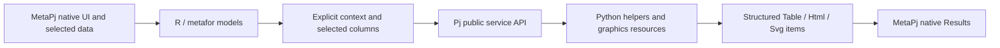

# MetaPj

**A source-code example and practical guide for jamovi module developers.**
[Leggi in italiano](README_IT.md).

MetaPj demonstrates how a specialised module can offer Python calculations,
interactive graphics and user-written extensions through the **public Pj API**,
while keeping its own interface, data contract and statistical methods. Its
working example is an independent-study meta-analysis with three input workflows:
**dichotomous outcomes, mean differences and generic effect sizes**. Each can use
the common-effect FE and random-effects RE models.

The purpose is to provide code that developers can read, run and adapt, saving
them from rebuilding Python execution, helpers and graphics resources in every
module. MetaPj is distributed as an example repository, **without a GitHub Releases
channel**. Two optional JMO files in the repository root let readers try the
example without compiling it. The example bundle is version **1.1.0**.

MetaPj owns its native controls, R/metafor meta-analysis and result containers.
The separately installed Pj module supplies Python discovery/execution,
cancellation, helpers, offline D3/Plotly/Chart resources and structured results.
MetaPj does not bundle Pj, duplicate its editor or build another graphics engine.



## Download the example

| Platform | Optional installable example |
| --- | --- |
| Windows x64 | [MetaPj_1.1.0_win64.jmo](MetaPj_1.1.0_win64.jmo) |
| Linux x64 | [MetaPj_1.1.0_linux.jmo](MetaPj_1.1.0_linux.jmo) |

Download the actual `.jmo` file, rather than saving its GitHub HTML page. Install
it using jamovi's module menu **Sideload**, then restart jamovi. The matching Pj
module must also be installed. These files accompany the source example; there
is no MetaPj release, automatic-update channel or submission to the jamovi Library.

## Requirements and installation

- jamovi **28.18.0 or later**, with a compatible R snapshot; supplied builds target Windows/Linux x64.
- **Pj 1.8.0 or later**, installed separately from [Pj releases](https://github.com/MAgojam/Pj/releases).
- MetaPj's JMO packages its R dependencies; it does not require Metafora.
- No Python plotly package, reticulate, web service or browser server is required.

Install the matching Pj and MetaPj JMOs and restart jamovi. Pj is discovered as a
sibling jamovi module at run time, without sourcing private Pj files or declaring
an R Imports dependency on Pj. If Pj is missing/outdated, MetaPj explains how to
install it and retains its R statistical tables. An interpreter failure likewise
leaves valid R results available. Embedded/System Python is selected in MetaPj
and passed explicitly to every service call; no editor analysis is opened.

## Try the supplied Data Library examples

1. **BCG vaccine — dichotomous outcomes**: open the example, add a new MetaPj
   analysis and select Dichotomous. Assign study label `study`, events/non-events
   for group 1 `tpos`/`tneg`, and group 2 `cpos`/`cneg`. Begin with RR and FE+RE.
2. **Mean differences — Normand 1999**: select Mean differences. Assign `study`,
   then `n1i`, `m1i`, `sd1i`, `n2i`, `m2i`, `sd2i`. Begin with MD and FE+RE.
3. **Generic effects — BCG precomputed log RR**: select Generic effect sizes
   and Log ratio. Assign `study`, `yi`, then `vi` for variance, `sei` for SE,
   or `ci_lower` / `ci_upper` with input CI level 95. See the
   [generic-input guide (English/Italian)](docs/mzMp_generic_effects.md).

| Input workflow | Required numeric columns in the supplied example | Measures / interpretation |
| --- | --- | --- |
| Dichotomous | `tpos`, `tneg`, `cpos`, `cneg` | RR, OR or RD. `tneg`/`cneg` are **non-events**, not total sample sizes. |
| Mean differences | `n1i`, `m1i`, `sd1i`, `n2i`, `m2i`, `sd2i` | MD or Hedges' SMD. SD columns are standard deviations, not standard errors. |
| Generic effect sizes | `yi` with **one** of `vi`, `sei`, or `ci_lower` + `ci_upper` | Supplied effect scale or already-logged ratio scale; select the corresponding uncertainty input. |

`study` is an optional study label. Each row is one independent study/effect;
use numeric variables for the required summaries. Generic variance/SE must be
positive. Generic CI inputs must be approximately centred, symmetric normal-Wald
intervals on the **same analysis scale** as `yi`; specify their input confidence
level. For log ratios, supply log effects and log CI limits, not raw ratios.

Sources are metadat::dat.bcg and metadat::dat.normand1999. See their metadat help
pages for study provenance. The OMVs contain data rather than a saved analysis.
Changing an opened Data Library example does not overwrite the library original:
jamovi requests a new file name/location when saving modifications.

The three native tabs retain independent measure/input selections and share the study
label, model settings, presentation and Python extension. One row represents one
independent study/effect. RR/OR/RD, independent-group MD/SMD and generic effects are supported;
paired, dependent, multilevel, subgroup and moderator models are outside this example.

## Statistics and presentation

R/metafor calculates escalc, common-effect inverse-variance FE and REML RE models
with z inference. Missing/non-finite summaries are excluded; invalid counts,
N or SD produce explicit errors. At least two usable effects with positive
sampling variances are required. RR/OR use a 0.5 correction in studies with zero
cells (only0) and drop00; RD uses no correction. SMD uses Hedges' correction.

RR/OR are fitted on the log scale. Native tables report transformed effects/CI,
while SE and z remain on the analysis scale. Study/model CI and RE prediction
intervals use the selected confidence level. Weights sum to 100% separately
within each selected model. These conventions do not change with the renderer.

Generic effects use supplied sampling variance, squared SE or variance
approximated from symmetric normal-Wald CI width at the supplied input level.
The input CI level is distinct from the output confidence level. Choose supplied
scale or already-logged ratio inputs with exponentiated display; no input scale
is inferred or silently transformed. Generic data validation and scale conventions
are detailed in the [generic-input guide](docs/mzMp_generic_effects.md).

- **D3** calls Pj's existing `mzpjShowIntervals`: supplied study and pooled CI,
  equal marker sizes, **analysis scale** (log RR/log OR for ratios), null = 0.
  It is an interval display, not a weighted-square/diamond forest renderer.
- **Plotly** calls Pj's dictionary-based helper for a forest with hover, weighted
  study squares, pooled diamonds, RE prediction interval and logarithmic ratio axis.
  The modebar is hidden by default; normal interactions remain available in Html.
- **Chart.js** calls Pj's helper with interval-series configuration. Numeric row
  positions follow the study table; pooled rows are last. The floating legend
  supplies the study/model labels. Ratio axes are logarithmic.

The default forest uses D3 intervals. Chart.js intervals and the Plotly forest remain selectable.
The renderer selector applies to the forest.
The descriptive funnel uses Pj Chart.js, and optional leave-one-out uses Pj Table/D3 helpers.
In Interactive HTML the funnel has an accordion with a 60–140% figure-size slider
and Reset; the complete reserved area scales with the figure. This host UI wraps
Pj's public Chart/Html output unchanged. Forest–funnel linked selection is deferred.

Choose **Interactive HTML** or **Native SVG**, then width/height. Html uses Pj's
existing interaction/accordion controls. Native Svg uses jamovi's own container;
no extra Html zoom wrapper is added. Plotly/Chart Svg contains a raster-backed
export; D3 Svg is vector. Browser-generated Image capture is specific to Pj's
editor and is deliberately not reimplemented here. Selected helper output must
be supported by this host; unsupported types produce an extension error.

On affected Ubuntu installations the native resize grip may be lower-left and
blocked, also in third-party modules. Use the module's width/height controls.

## Funnel and leave-one-out

The funnel plots the analysis-scale effect against SE (reversed axis), centred on the RE pooled estimate when selected, otherwise FE. Its pseudo-CI region uses the selected confidence level without adding tau²; it is not a prediction interval. It is descriptive, with no automatic publication-bias verdict or asymmetry test.

Enable leave-one-out to refit each selected model with metafor while omitting one included study at a time. Pj presents the resulting estimates/CI and heterogeneity. The interval plot uses the analysis scale and marks the full-data pooled estimate. This preview requires at least three included studies for that optional diagnostic.

## One personal Python script per analysis

Download or clone this repository (a repository ZIP is sufficient) to obtain
the `examples` folder. The JMO installs the module and Data Library datasets;
the external Python example files are loaded from your local repository copy.

Expand **Python extension (optional)** and select **Load script…** to load one
UTF-8 `.py` file (maximum 256 KiB). It replaces the current draft, not the active
code, and **does not execute it**. Edit the draft, then press **Run Python extension**.
The file name and Draft/Applied/Disabled state remain visible. **Save script…**
saves the edited text as a local `.py`; **Disable extension** retains the draft.
Applied code, script name and passive draft are stored in the OMV analysis.

Define a function; MetaPj calls it after sending the script to Pj:

```python
def mzRender(context):
    mzpjShowTable([
        {'Study': s['study'], 'R effect': s['yi'], 'Variance': s['vi']}
        for s in context['studies']], name='my_report', title='My study report')
```

`context` contains R results, semantic input-column mappings and presentation
settings. Pj's `data` contains only the selected source columns, before MetaPj's
complete-case exclusions; `context['studies']` contains the included effects.
See the [developer guide](docs/mzMp_developer_guide.md) and
[guida italiana](docs/mzMp_developer_guide_it.md) for row alignment and scales.
No Python object modifies an R model or a jamovi option automatically.

Ready-to-load scripts:

- [Report, precision and pooled comparisons](examples/mzMetaPj_extension_demo.py).
- [Explore selected source data](examples/mzMetaPj_input_explorer.py).
- [Personal tau² weight scenarios using Pj's helper](examples/mzMetaPj_weight_sensitivity.py).
- [Chart.js cumulative weight concentration](examples/mzMetaPj_weight_concentration.py):
  compare how many ranked studies account for most weight in each selected model;
  use the existing Pj paired explorer to link FE/RE study profiles and weight differences.
- [Plotly heterogeneity-weight heatmap](examples/mzMetaPj_heterogeneity_map.py):
  compare user-chosen tau² scenarios with annotated weight percentages and a
  muted diverging scale for percentage-point changes from tau² = 0.
- [D3 source completeness and reshape](examples/mzMetaPj_source_audit.py):
  trace required input roles, missing values and rows excluded from the model.

- [Rust study-level bootstrap and timings](examples/mzMetaPj_rust_bootstrap.py):
  native mean/median percentile intervals, matching Python draws and agreement checks.
- [Rust batch sign-flip example and timings](examples/mzMetaPj_rust_permutation.py):
  exact or Monte Carlo sign patterns with batch row means and shared Python reference.

All eight scripts work with Dichotomous, Mean differences and Generic effect sizes, either Python,
and Html/Svg. Load one at a time; Run applies the draft. See the
[example guide (English/Italian)](examples/README.md) for controls and interpretation.
The [Rust resampling guide](docs/mzMp_rust_resampling.md) explains the equal-study
estimands, sign-invariance assumptions and timing scope. These demonstrations
do not refit or replace the inverse-variance metafor models.

For the Plotly heterogeneity map, select **D3 intervals** or **Chart.js intervals**
for the standard forest first. Multiple inline Plotly results duplicate a large
library and can exceed jamovi's 4 MiB engine-response limit. MetaPj checks the
complete serialized response, retains valid statistical tables and reports
oversized optional output instead of sending a message the receiver cannot accept.

Each script runs through the selected Pj interpreter. Errors show script/source
details separately; standard meta-analysis results remain available. Editing is
passive. Applied code is reevaluated when its context changes; unchanged stored
results are reused across fresh R analysis objects. Arbitrary Python has the
selected interpreter's permissions; saved analyses use jamovi's code authorization.

## Reuse in your module

The small [API consumer example](examples/minimal_consumer.R) and
[R connector/mapper](R/mzMp_bridge.R) show the boundary. Your module decides which
columns/results to expose and how to map returned Table/Html/Svg items to native
results. Pj handles the Python execution and helpers. Propagate jamovi's restart
condition, pass your own checkpoint, and keep a bounded timeout. Do not copy Pj
internals or its bundled libraries into the consumer.

## Read and adapt the source

| Location | Developer purpose |
| --- | --- |
| `R/mzMp_statistics.R` | Validate the selected summaries and fit FE/RE models with metafor. |
| `R/mzMp_bridge.R` | Discover installed Pj, call its public service and map structured results. |
| `R/mzMp_analysis.R` | Own the analysis lifecycle, native tables, cache and optional extension. |
| `R/mzMp_transport.R` | Bound the complete serialized analysis response and keep errors recoverable. |
| `inst/python/mzMp_present.py` | Present R results using existing Pj helpers. |
| `jamovi/` | Native input tabs, options, result declarations and personal-script controls. |
| `examples/` | Eight Python extensions and a minimal R API consumer. |
| `docs/` | Developer, generic-input and resampling guides in English/Italian. |
| `tools/` | Reproduce module declarations and the generic example dataset. |

Start with [minimal_consumer.R](examples/minimal_consumer.R), then follow the
connector and lifecycle in the [developer guide](docs/mzMp_developer_guide.md).
Expose only the required data, preserve row identity, pass a bounded timeout
and the host checkpoint, and map only the result types supported by your module.
Python and returned HTML execute with their normal permissions; this API is
not a restricted-code sandbox.

To build an adapted copy, install compatible jamovi development tools and R
dependencies, open the source directory in R and run `source('compile.r')`.
`DESCRIPTION` records the metafor dependency and pinned source revision. Pj is
required at runtime, not copied into the source or rebuilt by MetaPj.

Only source, documentation, example datasets/scripts and the two optional JMO
files belong in this repository. Build folders, test harnesses, screenshots,
diagnostic sessions, logs and private work records remain local and are not
distributed. There are no MetaPj release or publication workflows.

The project is GPL >=2; dependency copyrights/licenses are preserved. MetaPj is
an independent developer example, not a Metafora release or a jamovi Library submission.
